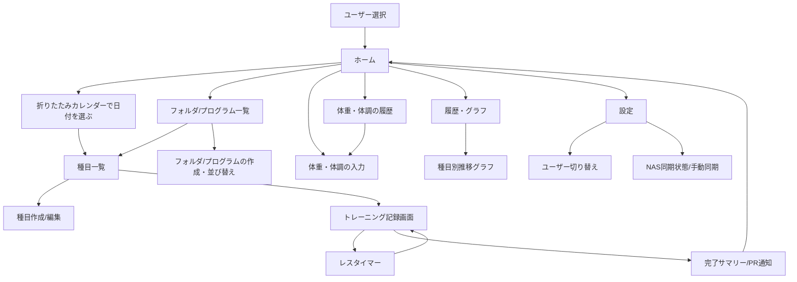
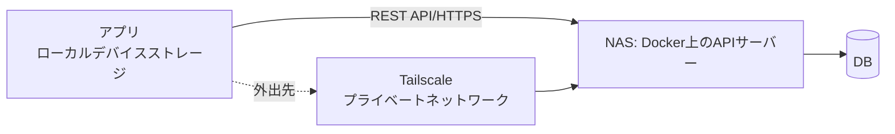

# 筋トレ記録アプリ 仕様書

2026-09-19 · @そーいち

## 概要・目的

既存の筋トレ記録アプリは種目のマスタが固定されており、自分の使いたい種目名・部位・器具の組み合わせで自由に登録できないことが多い。本アプリは「種目設定の自由度の高さ」を最大の価値とし、利用者が自分のトレーニングスタイルに合わせて種目・記録項目・グルーピングを自由にカスタマイズできる筋トレ記録アプリを提供する。

想定ユーザーは本人に加えて家族など複数人。データはSynology NAS上に保存し、自宅・外出先(ジムなど)の両方で記録・閲覧できることを目指す。

## MVP機能一覧

| 機能 | 内容 |
| --- | --- |
| 基本の記録 | 種目・重量×回数をセット単位で記録、RMも自動表示 |
| 前回値表示 | 同じ種目の前回記録を自動表示し、差分入力でのだけ入力できる |
| レスタイマー | セット間の休憩時間をカウントダウン表示・通知 |
| 履歴・グラフ表示 | 重量推移やボリューム(重量×回数×セット数)の推移をグラフで表示 |
| 自己ベスト更新通知(PR) | 最高重量・最高回数・最高ボリュームを更新した際に通知 |

### フェーズ2以降の候補(参考)

- トレーニングプログラムの自動提案・進捗管理
- 他ユーザーとの記録比較・共有機能の強化
- ウェアラブル連携(心拍数など)→Apple Watch

## 種目管理仕様

本アプリの中核機能。種目はマスタデータではなく全てユーザーが自由に作成・編集できる。
マスターデータはある程度用意しておき、そこにない場合はユーザーが自由に作成・編集できる。

### 種目の基本情報(自由入力)

| 項目 | 内容 |
| --- | --- |
| 種目名 | 自由テキスト入力(既定リストなし) |
| 部位 | 自由テキスト入力または選択(胸・背・肩・腕・脚・尻・全身など)を自由に追加可能 |
| 使用器具 | 自由テキスト入力(バーベル・マシン・自重など) |

### 種目ごとの記録項目カスタマイズ

デフォルトは重量×回数だが、種目作成時に記録項目を選択できる。

| 記録項目 | 向いている種目例 |
| --- | --- |
| 重量 × 回数 | ベンチプレスなど一般的な筋トレ種目 |
| 時間 | プランクなどアイソメ系 |
| 距離 | ランニング・ロウイングなど有酸素系 |
| RPE(主観的運動強度) | 高強度トレーニングの負荷管理 |
| メモ(フリーテキスト) | フォームの気づき等を自由記述 |

- 複数項目の組み合わせも可(例: 重量×回数×RPE)
- MVPでは上記の組み合わせのみ。ユーザー自定義項目はフェーズ2以降で検討

### 並び替え・テンプレート化

- 種目の表示順はドラッグで並び替え可能
- よく使う種目セットを「テンプレート」として保存し、次回以降はそこから選んで開始できる
- 種目の複製機能は設けない(部位別のプリセットから選べるため、複製で省けるのが器具名の入力程度にとどまり、一覧の操作を増やす割に利点が小さいと判断)

### フォルダ/プログラムでのグループ化

「胸の日」「脚の日」「背中・二頭日」のように、種目をフォルダ(プログラム)単位でまとめられる。フォルダはユーザーが自由に作成・名前変更し、1種目を複数フォルダに所属させることも可能とする。

## トレーニング記録画面の仕様

### 入力フロー

1. フォルダ/プログラムまたは種目リストから種目を選択
2. 選択した種目の直近の記録を、各セットの入力欄に初期値として自動入力する(前回の一覧表示は履歴画面で確認する)
3. ユーザーは変更がある部分のみ入力(差分入力)。値を変えなければチェックだけで前回と同じ値を確定できる
4. セット完了ごとに「次のセットへ」ボタンでレスタイマーが自動起動
5. 全セット完了後、自己ベストを更新していればその場で通知

### 画面要素(例: 重量×回数種目の場合)

| セット | 今回(入力) |
| --- | --- |
| 1セット目 | 60kg × 10回(前回値が初期入力済み。変更あれば上書き) |
| 2セット目 | 60kg × 9回 |

- 「+セット追加」では、前回に同じ番号のセットがあればその値、無ければ直前のセットの値を入れる
- 前回値は触るまで「未入力」扱い(未完了表示・離脱時の警告・記録の対象にならない)。チェックまたは編集で記録される
- チェック済みのセットはもう一度チェックを押すと外れ、値を修正できる。修正後は再チェック、または完了ボタン・離脱時の確認で保存し直す
- 重量・回数は数字キーパッドで素早く入力(例: +2.5kg / -1回のステッパーボタン)
- 種目の記録項目設定に応じて入力欄が動的に変わる(時間/距離/RPEなど)

### 過去日の記録

過去の記録の修正・入力のため、記録する日を選べる。日付はホームの折りたたみカレンダーで選び、
プログラム → 種目一覧 → 記録の各画面へ引き継ぐ(`Record` / `ExerciseList` の `date` パラメータ。
`YYYY-MM-DD`、省略時は今日)。

- **カレンダー(ホーム)**: 初期は1週間分(1行)。▾で月表示、▴で週表示に戻る。記録がある日はドット、今日は枠、
  未来の日付はグレーで選べない
- **種目一覧**: 上部に週表示を置く。見出しは「10月21日(水)の記録」の形式(今日も同じ)。
  記録がある種目は✓と選択日のセット内容、無い種目は＋と前回の日付・値(選択日より前の最新の記録)を表示
- **記録画面**: 上部に日付と前日・翌日ボタンを表示し、保存先の日付を常に見えるようにする(過去日は色を変える)。
  未来の日には移れない
- 日付の判定は「選んだ日のローカル0時〜翌0時」
- 前回値は「選んだ日より前の最新の記録」。未来の記録は前回値として拾わない
- 過去日の新規記録の保存時刻はその日の正午(タイムゾーンで日付がずれないようにするため)。今日は現在時刻
- 他アプリからのデータ移行(CSV取り込みなど)は対象外

## 画面遷移図

### 主要画面一覧

| 画面 | 役割 |
| --- | --- |
| ユーザー選択 | 起動時に表示。パスワードなしでタップだけで切り替え |
| ホーム | 折りたたみカレンダー(記録する日の選択)・プログラム一覧・PR通知への入り口 |
| フォルダ/プログラム一覧 | 「胸の日」などのグループ単位で種目一覧へ |
| 種目一覧 | フォルダ内(または全体)の種目を並び替え・選択。新規作成・編集もここから |
| トレーニング記録画面 | 前回値自動表示+差分入力、セット完了でレスタイマー起動 |
| 完了サマリー | その日の記録まとめとPR通知 |
| 履歴・グラフ | 種目別の重量・ボリューム推移グラフ |
| 体重・体調の入力 | 体重(数字キーパッド)・体調(5段階)・排便をその日の分だけ記録する。モーダル |
| 体重・体調の履歴 | 体重の推移グラフと一覧。期間(1週間/1ヶ月/3ヶ月/1年)と粒度(日ごと/平均)を選ぶ |
| 設定 | ユーザー切り替え、NAS接続設定・手動同期 |

[ワイヤーフレームを見る](https://claude.ai/artifact/D7QQaasNbk8qmBguPBfLrw)(ユーザー選択/ホーム/種目一覧/記録画面/履歴/設定の6画面)

## 体重・体調の記録(日次記録)

筋トレの記録とは別に、その日の体重・体調・排便を1日1行で残す。種目に属さないため
`workout_logs`とは別の`daily_logs`テーブルを使い、`user_id`と日付で一意にする。

| 項目 | 内容 |
| --- | --- |
| 体重 | kg、小数1桁。数字キーパッドで入力する |
| 体調 | 5段階(1 とても悪い 〜 5 とても良い) |
| 排便 | あり / なし |

- 入力の入口はホーム。カレンダーで選んだ日の要約バーをタップしてモーダルを開く。
  要約バーはスクロールしない位置に置き、プログラム一覧だけがスクロールする
- 触っていない項目は保存しない(未入力のまま残る)。体重の前回値は表示だけで、
  タップすると同じ値が入る
- 体重は20〜300kgの範囲外を保存できない。打ち間違いをそのまま残さないため
- カレンダーでは、体調を背景の緑の濃さ(1〜5)で示す。トレーニングの記録がある日の
  ドットは黒。緑の最も濃い色は中間色にとどめる(濃いと黒い日付とドットが読めなくなるため)
- 体重はカレンダーには出さない。要約バーと履歴で見る
- 履歴のグラフは期間を1週間・1ヶ月・3ヶ月・1年から選ぶ。粒度は期間ごとに既定を決め
  (1週間・1ヶ月は日ごと、3ヶ月は週平均、1年は月平均)、グラフ見出しの2択で変えられる。
  期間を変えると既定に戻す(期間ごとに適した粒度が違うため)
- 1週間のときは粒度を出さない。平均にすると1点になってしまうため
- 平均は週(月曜始まり)または暦月で区切る。カレンダーの区切りと合わせるため。
  一覧もグラフと同じ区切りで出す
- 同期は他のテーブルと同じLast Write Wins。2台が同じ日の記録を別idで作った場合は、
  日付の粒度で既存行を探して1日1行に保つ(自己ベストと同じ方式)
- ただし1行に3項目あるため、行ごとの上書きだけでは片方が消える(1台目が朝に体重、
  2台目が夜に体調だけ入れると、後から来た行が体重をnullで上書きしてしまう)。
  アプリに項目を消す操作は無く、nullは必ず「まだ記録していない」なので、
  nullの項目は既存の値を残す。排便の「なし」は未入力ではないので上書きする。
  その日の記録ごと消すときは`deleted_at`を使う
- 体調は1〜5の範囲をサーバー側でも検証する。範囲外はカレンダーの色が決まらないため

## レスタイマー・Dynamic Island仕様

アプリをバックグラウンド/完全に閉じても休憩タイマーのカウントダウンを継続し、Dynamic Island・ロック画面に残り時間を表示する。

### 要件

| 項目 | 内容 |
| --- | --- |
| カウント継続 | アプリを閉じても休憩時間のカウントダウンが止まらない |
| Dynamic Island表示 | 残り時間をDynamic Islandに常時表示。タップでアプリに戻れる |
| ロック画面表示 | ロック画面にも同様に残り時間を表示 |
| 終了通知 | 休憩終了時に通知。イヤホン(Bluetooth・有線問わず)接続中はアラーム音をイヤホンから再生 |

### 実装方式(方針)

- iOSのLive Activities(ActivityKit)を利用。Live ActivityはOSが直接カウントダウン表示を更新する仕組み(残り時刻ベースのタイマー表示)を持つため、アプリ本体がバックグラウンドで動き続ける必要はない
- React Native本体はActivityKitを標準ではサポートしないため、Swiftで書いたネイティブモジュール(自作またはreact-native-live-activities等のライブラリ)を組み込む
- 休憩終了アラームはカウントダウン開始時にローカル通知(UNUserNotificationCenter)を終了時刻で予約し、サウンド付きで発火させる(アプリがバックグラウンドでも確実に鳴る)
- サウンドは端末のオーディオ出力先(スピーカー/接続中のイヤホン)にiOSが自動でルーティング(アプリ側で接続判定ロジックを作る必要はない)
- Live Activityの最大継続時間(通常8時間程度)は休憩タイマーの用途上制限にならない想定

※AndroidにはDynamic Island相当の機能がないため、将来Android展開する際は通常の通知+フォアグラウンドサービスで代替

## データ保存・同期アーキテクチャ

Synology NASをバックエンドとし、Docker上でAPIサーバーを稼働させる方式を採用する。

### 全体構成

### データフロー

| 状況 | 動作 |
| --- | --- |
| 自宅ネットワーク接続時 | アプリがNAS上のAPIに直接アクセスして読み書き |
| 外出先(ジムなど) | アプリはローカルに一時保存してオフラインでも記録可能 |
| 外出先 + Tailscale接続時 | NASのAPIに直接接続して読み書き(自宅接続時と同じ挙動・同じアドレス) |
| アプリ起動時 | 未同期のローカル変更を検知し、NASと自動で差分同期(ユーザー操作不要) |

### 構成要素(例)

| 要素 | 内容 |
| --- | --- |
| サーバー | Dockerコンテナとして NAS上で稼働(Node.js + Express で確定) |
| DB | SQLiteをNASボリューム上のファイルとして永続化 |
| 通信 | REST API over HTTP(自宅・外出先とも同一エンドポイント)。通信路はTailscaleが暗号化する |
| 外部接続 | Tailscale(NASとiPhoneを同じプライベートネットワークに入れる)。ルーターのポート開放は不要 |

- 衝突解決は最後に保存した方で上書き(Last Write Wins)。`updated_at`が同時刻の場合は
  端末ごとに結果がぶれないようサーバー側を残す
- 「どこまで受け取ったか」は端末の時計ではなくサーバー内部の連番(`server_seq`)で追う。
  端末の時計がずれていても変更を取りこぼさないため
- サーバーの実装は`server/`(Express + SQLite + Docker)。手順とAPIは`server/README.md`

## マルチユーザー対応

家族など複数人で同一NASを共有し、ユーザーごとにデータを完全に分離する。

| 項目 | 方針 |
| --- | --- |
| ユーザー作成 | NASのAPI側でユーザーを登録(人数は少数想定) |
| ログイン | ユーザー選択のみ(パスワードなし)。新規ユーザー追加後は再ログイン時に一覧から選ぶだけ |
| データ分離 | 種目・記録・自己ベストは全てユーザー単位で管理し、他ユーザーのデータは見えない |
| ユーザー切り替え | 同一端末で複数ユーザーを切り替えて使うケース(家族共用端末)はフェーズ2以降で検討 |

※種目テンプレートの家族間共有は不要。各ユーザーのデータは完全に独立したデータとする。

## 技術スタック

| 層 | 候補 | 備考 |
| --- | --- | --- |
| アプリ(クライアント) | React Native | 確定。Dynamic Islandを使いたいため、休憩タイマー部分はLive Activities(ActivityKit)を使うSwiftネイティブモジュールをReact Nativeに組み込む必要あり |
| ローカル保存 | 端末内DB(例: SQLite系) | オフライン時の一時保存・同期キューに使用 |
| 通信 | REST API over HTTP | NAS上のAPIサーバーと通信。インターネットに公開せず、Tailscale内でのみ到達できる |
| NASサーバー | Dockerコンテナ(例: Node.js + Express等) | Node.js + Expressで確定 |
| DB(NAS側) | SQLite | データ量・同時アクセス数を見て選定 |
| 認証 | ユーザー選択のみ、パスワードなし(MVP) | 少人数利用のため簡易方式で良い見込み。ユーザーを新規追加したら、再ログインでユーザーを選択できる(パスワードはまずは無くてよい) |
| 外部接続 | Tailscale | NASとiPhoneを同じプライベートネットワークに入れる |

## API/データベース設計(たたき台)

詳細実装は未確定だが、データ構造のたたき台として以下を想定。

### 主要エンドポイント

アプリは常にローカルDBを読み書きし、サーバーとは差分同期だけでやり取りする(オフラインでも
操作を止めないため)。そのため種目・記録ごとのCRUDエンドポイントは設けず、`POST /sync`に一本化した。

| Method | Path | 内容 |
| --- | --- | --- |
| POST | /sync | 差分同期。ローカルの変更を送り、前回以降のサーバー側の変更を受け取る |
| GET | /users | ユーザー一覧(ログイン画面用) |
| GET | /health | 起動確認 |

リクエスト・レスポンスの詳細は`server/README.md`を参照。

### 主要テーブル(例)

| テーブル | 主なカラム |
| --- | --- |
| users | id, 名前, updated_at, deleted_at |
| folders | id, user_id, 名前, 並び順, updated_at, deleted_at |
| exercises | id, user_id, 種目名, 部位, 器具, 記録項目定義(JSON), updated_at, deleted_at |
| folder_exercises | folder_id, exercise_id, 並び順(複合主キー) |
| logs | id, exercise_id, 日付, 完了フラグ, updated_at, deleted_at |
| set_logs | workout_log_id, セット番号, 重量, 回数, 時間, 距離, RPE(可変項目) |
| personal_records | id, exercise_id, 種別(最高重量/最高回数/ボリューム), 値, 達成日, updated_at, deleted_at |
| daily_logs | id, user_id, 日付, 体重, 体調(1〜5), 排便, updated_at, deleted_at(UNIQUE(user_id, 日付)) |

※exercises.記録項目定義をJSONで持つことで、種目ごとの記録項目カスタマイズに柔軟に対応する想定。

※1つの種目を複数のフォルダ/プログラムに入れられるよう、所属は`folder_exercises`の多対多で持つ
(exercisesにfolder_idは持たせない)。

### 同期のための更新日時・論理削除

Last Write Winsで差分同期するため、同期の単位になるテーブル(users / folders / exercises /
logs / personal_records / daily_logs)は`updated_at`(更新日時)と`deleted_at`(論理削除日時)を持つ。

- 削除は物理削除せず`deleted_at`を打つ。物理削除では「削除された」ことを相手に伝えられず、
  同期時に削除済みデータが復活してしまうため
- 読み出しは常に`deleted_at IS NULL`で絞る
- `folder_exercises`と`set_logs`はidを持たず、それぞれフォルダ・記録の集約の一部として扱う。
  単独では同期せず物理削除のままとし、変更時は親の`updated_at`を更新する
- 論理削除では外部キーの`ON DELETE CASCADE`が発火しないため、削除の伝播
  (ユーザー → フォルダ・種目 → 記録・自己ベスト)はアプリ側で明示的に行う

## 今後決めること・オープン課題

- [x] (確定)React Nativeを採用。Dynamic Island対応(ActivityKitネイティブモジュール)の具体実装方法は別途検討
- [x] (確定)Node.js + Express + SQLiteを採用
- [x] 認証はユーザー選択のみ(パスワードなし)で確定。将来必要になったらパスワード/トークン方式を検討
- [x] (確定・2026年10月変更)外出先からの接続はTailscaleを使う。当初はSynology VPN Server
      パッケージで確定していたが、(1)ルーターのポート開放とDDNSが必要、(2)iOSのL2TP VPNは
      常時接続に向かず毎回手動接続になる、の2点から変更した。QuickConnectはDSMと純正パッケージ
      しか中継せず、自作コンテナのポートには使えないため選択肢にならない。
      ポート開放を伴う純正の代替(DDNS + リバースプロキシ + Let's Encrypt)は、認証の薄いAPIを
      インターネットに露出させることになるため採らない
- [x] (確定)オフライン編集が衝突した場合は最後に保存した方で上書き(Last Write Wins)
- [x] (確定)MVPでは重量・回数・時間・距離・RPEの5種類のみ。ユーザー自定義項目はフェーズ2以降
- [x] (確定)家族間のテンプレート共有は不要。各ユーザーのデータは完全に独立
- [x] (確定)NASの標準バックアップ機能(Hyper Backup等)に任せる。アプリ側の対応は不要
